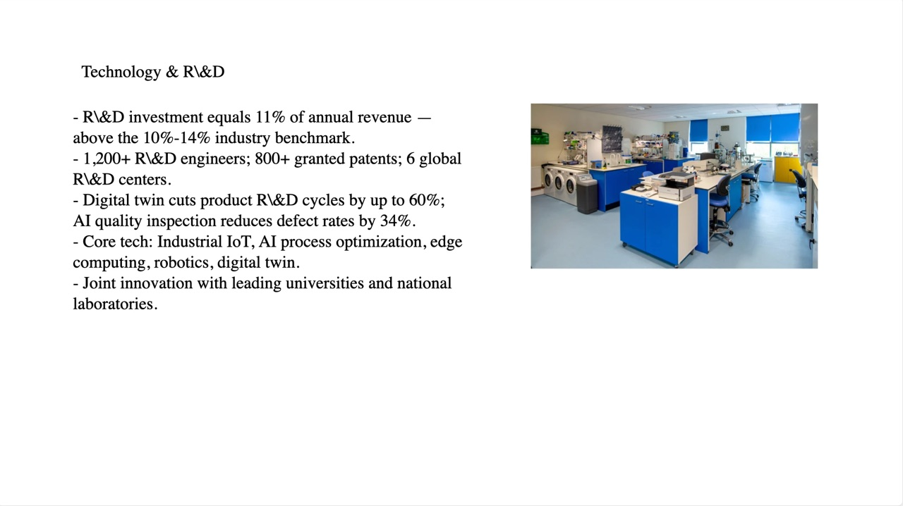
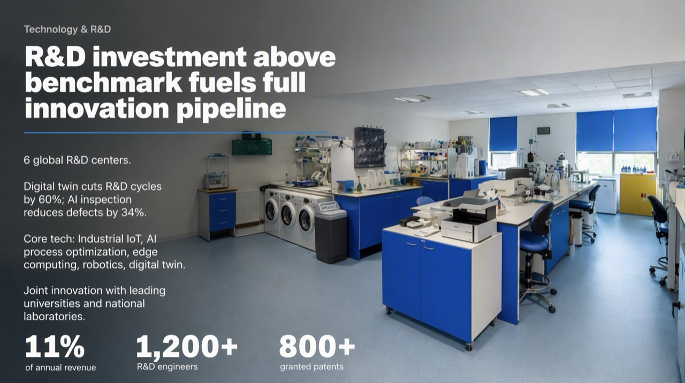
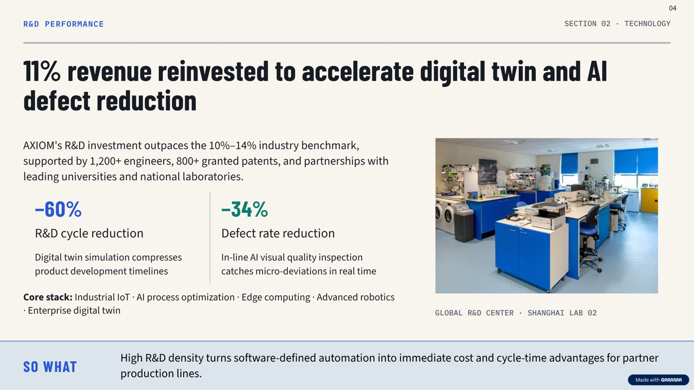
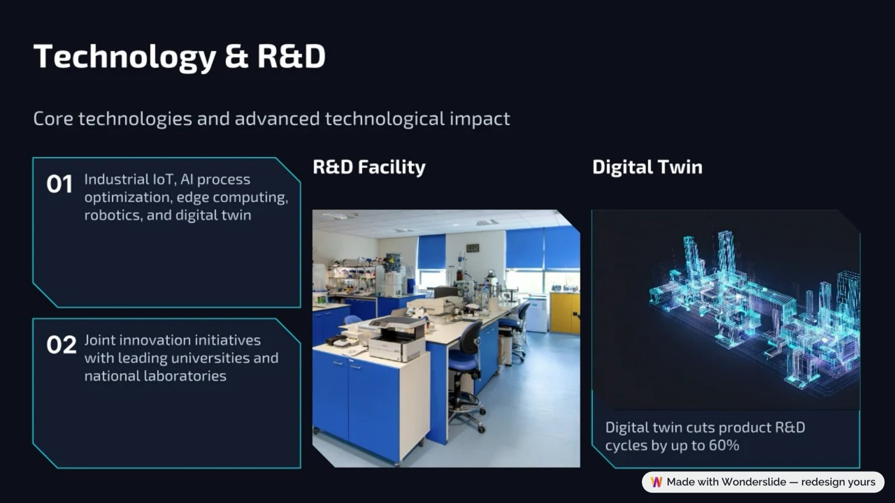
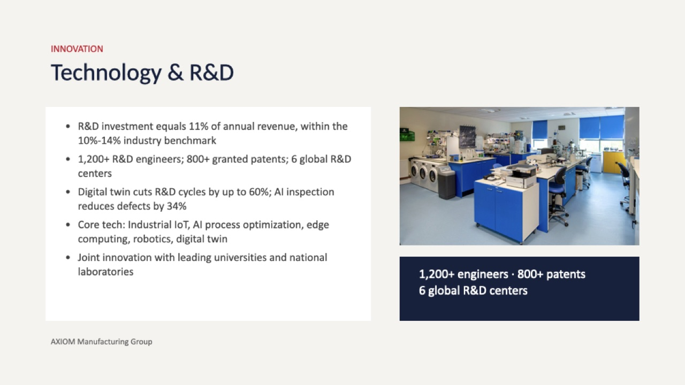

# AI PowerPoint Redesign Benchmark — one deck, four tools

We ran the same 8-slide PowerPoint through four AI tools that redesign an **existing** deck — **BetterPPT, Gamma, Wonderslide and Plus AI** — on **October 18, 2026**, and published the unedited exports plus a fact-by-fact check of what each tool kept, changed or added.

> **Disclosure:** this benchmark is maintained by the team behind [BetterPPT](https://betterppt.com). Treat it as a vendor test. To make it checkable, the source deck, every export image, each tool's settings and the scoring data are in this repo — rerun it and open an issue if you get different results.

Full write-up with commentary: https://betterppt.com/en/ai-powerpoint-redesign-tools-tested

## What's in this repo

| Path | Contents |
|---|---|
| `source-deck/axiom-sample-deck.pptx` | The 8-slide source deck (a fictional company, "AXIOM Manufacturing Group"). Mostly plain bullet slides; 7 photos on 3 slides. |
| `images/` | Exports for three slides — `cover-*`, `tech-*` (Technology & R&D, the data-heavy slide), `mfg-*` (Manufacturing). `*-original.jpg` is the source slide. |
| `data/results.csv` | Side-by-side comparison on 10 dimensions. |
| `data/facts-slide4.csv` | Every fact on the Technology & R&D slide, checked against each export. |

## Settings used

| Tool | Settings |
|---|---|
| BetterPPT | Uploaded the .pptx, answered the setup questions, downloaded the HD image version. |
| Gamma | Imported the .pptx into Gamma's redesign agent, answered its setup form, accepted its suggested direction, exported the slides. |
| Wonderslide | "Improve and refine (Recommended)" + "Modern Tech"; downloaded the free (watermarked) PDF. Re-run later with "Preserve exact structure" — numbers were kept in that mode. |
| Plus AI | Prompt: "redesign and make it look better and professional" in the Plus AI editor (Basic plan); exported the PPTX. |

## Results at a glance

| | BetterPPT | Gamma | Wonderslide | Plus AI |
|---|---|---|---|---|
| Layout | Each slide designed individually | Template-based, consulting-style blocks | Style preset, cards | Template-style, cards |
| New imagery | Most slides | Generated cover | Some slides | None in this test |
| Original photos | Re-composed | As-is | As-is in cards | As-is |
| Text on data slides | Figures kept, enlarged | Figures kept; headlines rewritten, summary lines added | Most figures dropped in default mode | Kept as written |
| Editing | Download .pptx (no in-browser editor) | Built-in editor | Built-in editor | Built-in editor |
| Time | ~15–20 min / 30 slides | ~5–6 min | ~5–6 min | not timed |
| $99 ≤30 slides on Oct 18; now $39 ≤30 slides, $59 for 31–50 (since Oct 19), one-time
\* Gamma's pricing page blocked our checker; range from third-party listings. Check gamma.app/pricing.

## The data-heavy slide (Technology & R&D)

| Fact in the original | BetterPPT | Gamma | Wonderslide (Improve) | Plus AI |
|---|---|---|---|---|
| R&D spend = 11% of revenue | kept | kept | dropped | kept |
| 10%–14% benchmark | folded into title | kept | dropped | kept |
| 1,200+ R&D engineers | kept | kept | dropped | kept |
| 800+ granted patents | kept | kept | dropped | kept |
| 6 global R&D centers | kept | dropped | dropped | kept |
| R&D cycles up to 60% shorter | kept | kept | kept | kept |
| 34% fewer defects | kept | kept | dropped | kept |
| Core technology list | kept | kept | kept | kept |
| University / lab partnerships | kept | kept | kept | kept |

Gamma also **added** text that isn't in the source: a "So what" summary line on each slide and a photo label ("Global R&D Center · Shanghai Lab 02").

| Original | BetterPPT | Gamma | Wonderslide | Plus AI |
|---|---|---|---|---|
|  |  |  |  |  |

## Limitations

- One deck, one run per tool, one date. AI output varies between runs and tools change often.
- Wonderslide was scored in its default "Improve and refine" mode; its "Preserve exact structure" mode kept the numbers.
- Plus AI and Wonderslide were tested on their standard flows, not every option they offer.

## License

Text and data: CC BY 4.0. The source deck is fictional sample content and may be reused for testing. Export images are outputs of each named tool from our own source deck and are shown for comparison; product names belong to their owners.
